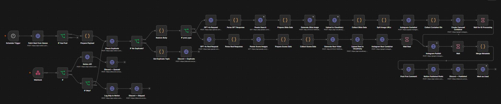
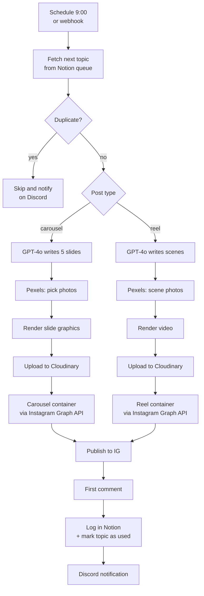

🇬🇧 English | 🇵🇱 [Polski](README_PL.md)

[← Back to portfolio](../../README.md)

# Instagram content automation (n8n)

An n8n workflow that turns a topic from a Notion database into a finished Instagram post: a carousel or a reel. It writes the copy, picks photos, generates graphics or video, publishes the post, adds the first comment and logs the result in Notion. Every step is reported on Discord.

**Scale:** 45 nodes · runs daily at 9:00 · live on the @calmyourtech account

*The full workflow in the n8n editor: top branch = carousel, second branch = reel.*

## How it works

## What this project shows

- **Working with APIs:** Instagram Graph API, OpenAI, Notion, Pexels, Cloudinary, Discord webhooks; HTTP requests with headers and parameters
- **Data consistency:** duplicate check before publishing, marking used topics, logging every publish and every skip
- **Logic and branching:** separate paths for carousels and reels, handling an empty queue, manually skipping a topic
- **JavaScript code:** parsing GPT responses, mapping Notion data, assembling slide and scene data
- **Prompt engineering:** a prompt with an example of target content and an enforced JSON format
- **Async handling:** waiting for Instagram to process media before publishing

## Related workflows

This workflow is part of a larger system:
- **Post Analytics – 24h Pull:** a day after publishing, pulls post metrics and follower count and saves them in Notion
- **Weekly Format Report:** compares reels vs carousels every week and sends a report to Discord
- **Trend Scout:** generates new topics every week and adds them to the Notion database

## Workflow file

[`workflow.json`](workflow.json) can be imported into n8n. All API keys, tokens, account and database IDs have been removed and replaced with placeholders like `YOUR_IG_ACCESS_TOKEN`.
