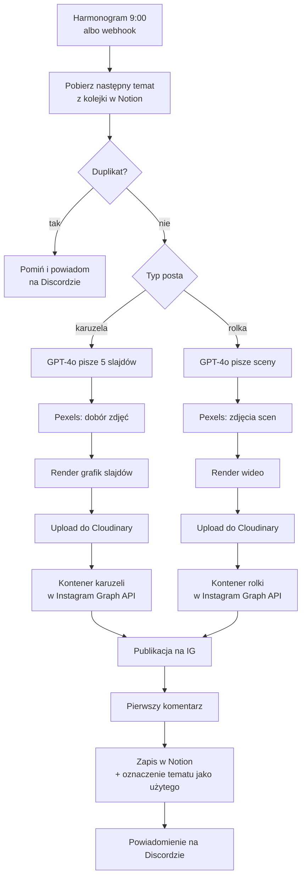

🇬🇧 [English](README_EN.md) | 🇵🇱 Polski

[← Wróć do portfolio](../../README.md)

# Automatyzacja treści na Instagramie (n8n)

Workflow w n8n, który zamienia temat z bazy w Notion w gotowy post na Instagramie: karuzelę albo rolkę. Sam pisze treść, dobiera zdjęcia, generuje grafiki lub wideo, publikuje post, dodaje pierwszy komentarz i zapisuje wynik w Notion. O każdym kroku informuje na Discordzie.

**Skala:** 45 węzłów · codzienne uruchomienie o 9:00 · działa produkcyjnie na koncie @calmyourtech

*Cały workflow w edytorze n8n: górna gałąź to karuzela, druga to rolka.*

## Jak to działa

## Co pokazuje ten projekt

- **Praca z API:** Instagram Graph API, OpenAI, Notion, Pexels, Cloudinary, webhooki Discorda; zapytania HTTP z nagłówkami i parametrami
- **Spójność danych:** sprawdzanie duplikatów przed publikacją, oznaczanie użytych tematów, log każdej publikacji i każdego pominięcia
- **Logika i rozgałęzienia:** osobne ścieżki dla karuzeli i rolki, obsługa pustej kolejki, ręczne pominięcie tematu
- **Kod w JavaScript:** parsowanie odpowiedzi GPT, mapowanie danych z Notion, składanie danych slajdów i scen
- **Prompt engineering:** prompt z przykładem wzorcowej treści i wymuszonym formatem JSON
- **Obsługa asynchroniczności:** oczekiwanie, aż Instagram przetworzy media, zanim post zostanie opublikowany

## Powiązane workflowy

Ten workflow jest częścią większego systemu:
- **Post Analytics – 24h Pull:** dzień po publikacji pobiera statystyki posta i liczbę obserwujących, zapisuje je w Notion
- **Weekly Format Report:** co tydzień porównuje wyniki rolek i karuzel i wysyła raport na Discorda
- **Trend Scout:** co tydzień generuje nowe tematy i dodaje je do bazy w Notion

## Plik workflowu

[`workflow.json`](workflow.json) można zaimportować do n8n. Wszystkie klucze API, tokeny, ID kont i baz danych zostały usunięte i zastąpione nazwami typu `YOUR_IG_ACCESS_TOKEN`.
